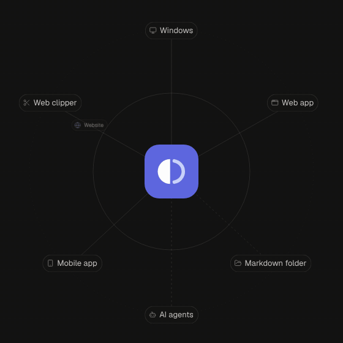
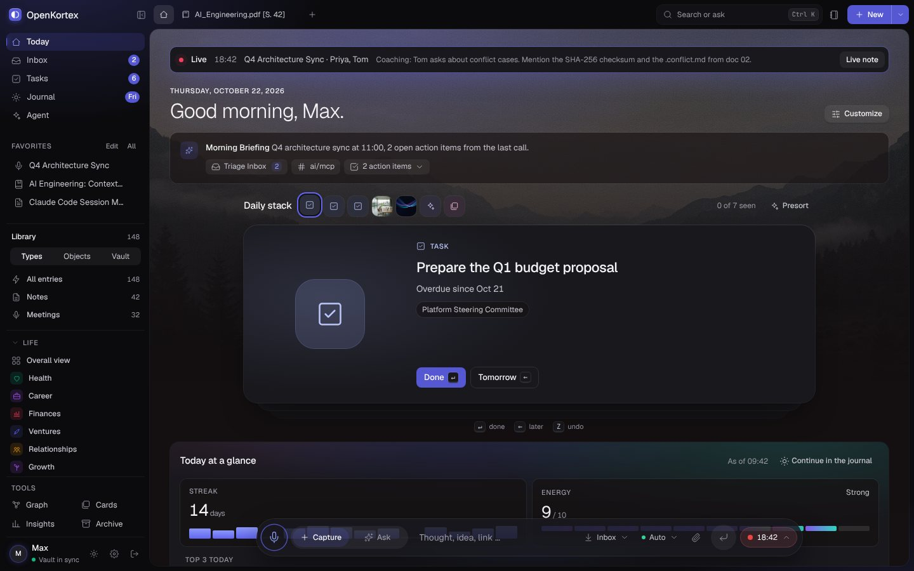
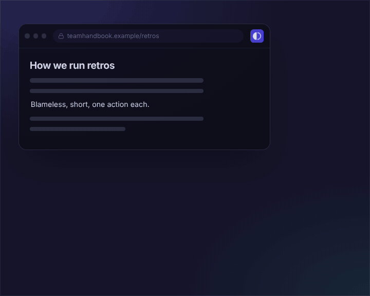
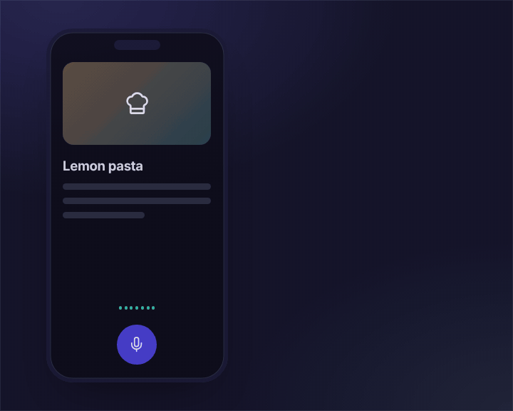
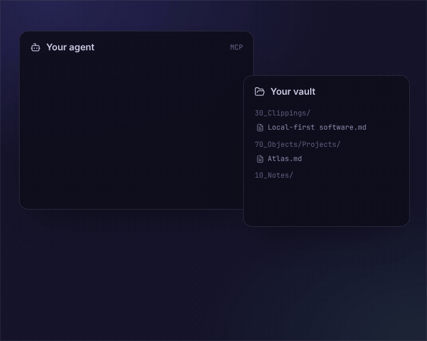
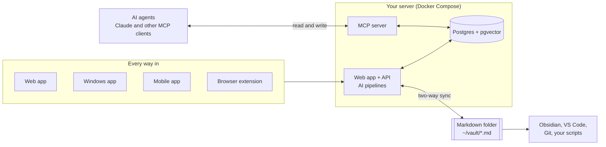
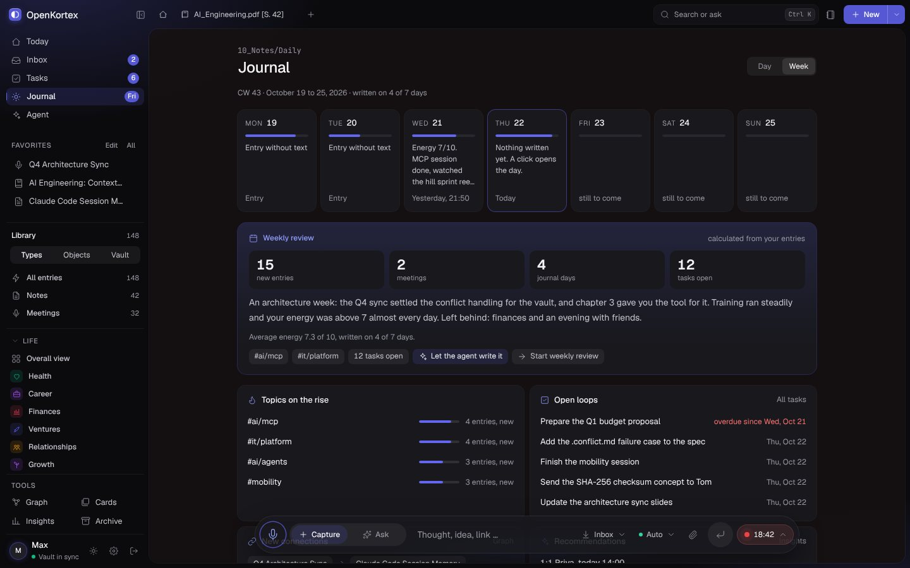
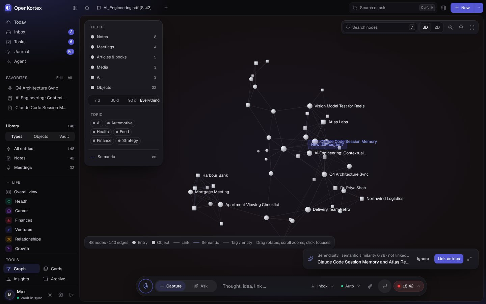
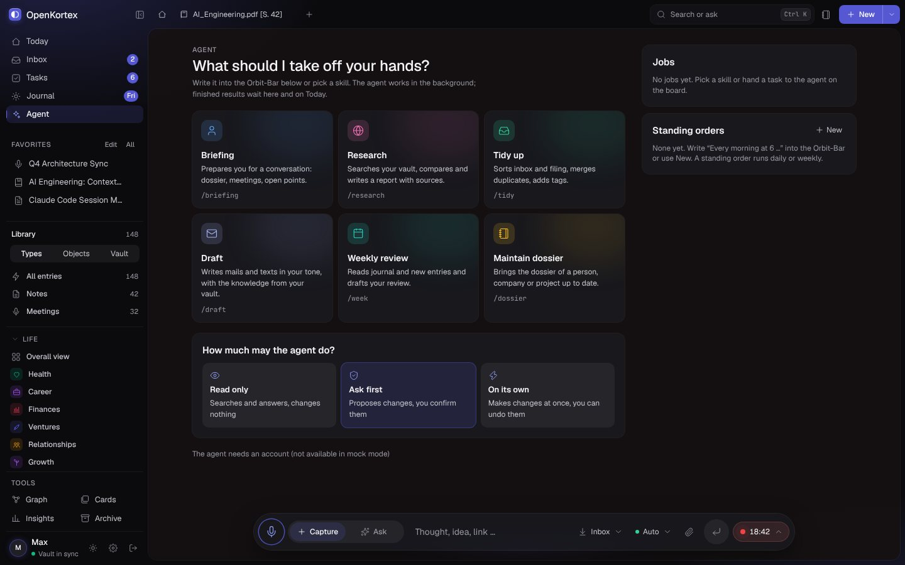
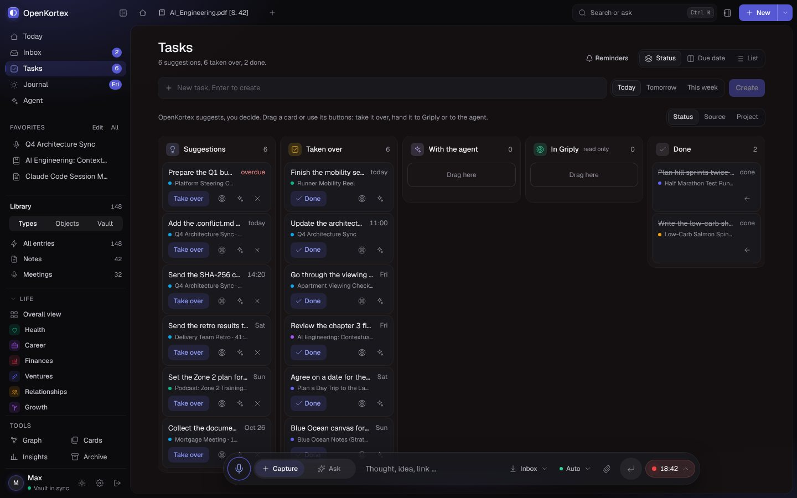

<p align="center">
  
</p>

<h1 align="center">OpenKortex</h1>

<p align="center">
  <b>Drop it in. Find it sorted.</b><br>
  The AI-native second brain you host yourself. Everything stays plain Markdown.
</p>

<p align="center">
  <a href="https://openkortex.pages.dev">Website</a> ·
  <a href="https://openkortex.pages.dev/home">Live demo</a> ·
  <a href="selfhost/README.md">Self-hosting guide</a> ·
  <a href="CONTRIBUTING.md">Contributing</a> ·
  <a href="https://github.com/moe-spiration/openkortex/releases">Releases</a>
</p>

<p align="center">
  <a href="LICENSE"></a>
  <a href="https://github.com/moe-spiration/openkortex/stargazers"></a>
  <a href="https://github.com/moe-spiration/openkortex/releases"></a>
  
  
</p>

<p align="center">
  
</p>

Drop anything into one inbox: thoughts, links, articles, PDFs, books, videos, podcasts, recipes,
photos, voice memos, meetings and chats with AI assistants. Background pipelines transcribe,
summarize, tag and connect it. Your AI agents can read and write the same knowledge. And all of it
lives as plain Markdown files that you can open, move or take elsewhere at any time.

> **Try it without installing:** the [live demo](https://openkortex.pages.dev/home) runs the whole web
> app in your browser with sample data. No account, no server, no AI.

## Why OpenKortex

- **Your notes are files.** Every entry is one `.md` file with YAML frontmatter, mirrored two-way to a folder on your computer.
- **Your server, your keys.** There is no OpenKortex cloud. It runs where you install it and only calls the AI providers you give a key to.
- **Your agents are welcome.** A built-in MCP server lets Claude and other agents search, read and save, with a token per agent you can revoke.
- **Every way in.** Web app, Windows app, Android app, browser extension, MCP server and Markdown sync, all talking to the same server.

## How it works

<table>
  <tr>
    <td width="50%"></td>
    <td width="50%">
      <h3>Clip the page, keep the sentence</h3>
      One click on the browser extension saves the page you are reading. Mark a sentence and it
      travels along as a highlight. A minute later the entry has a summary, tags and a folder.
      Articles, videos, recipes and products are each read the way they need; chats with AI
      assistants export as Markdown.
    </td>
  </tr>
  <tr>
    <td width="50%">
      <h3>Share it, say it, done</h3>
      On the phone, OpenKortex sits in the share sheet next to mail and messages: links, photos and
      files from any app. For everything that is not on a screen there is a button to hold and
      talk. Voice memos are transcribed and their tasks pulled out.
    </td>
    <td width="50%"></td>
  </tr>
  <tr>
    <td width="50%"></td>
    <td width="50%">
      <h3>Agents read your brain, and write to it</h3>
      The MCP server gives Claude and other agents the same knowledge you have. They search and
      read before they answer, and save what they worked out as normal entries, right next to
      yours. Six tools: search, read, save, organize, tasks and memory.
    </td>
  </tr>
</table>

## Nothing to escape from

Your whole brain exists as a folder of Markdown files. OpenKortex is one way to work with that
folder, not the place it is locked in.



- **Plain Markdown:** links are `[[wiki links]]`, tags are text. No export step, no proprietary format.
- **Headless:** the server needs no app in front of it. The MCP server and the Markdown sync run on their own.
- **Move at any time:** copy the folder to another computer, another server or another tool. A new server reads it back in.
- **Works without OpenKortex:** switch the server off and the folder still opens in Obsidian, VS Code or any text editor.

## The whole workspace

<table>
  <tr>
    <td width="50%"><br><sub><b>Journal</b>: a week of daily notes, energy and highlights side by side.</sub></td>
    <td width="50%"><br><sub><b>Graph</b>: every entry and object, and how they connect.</sub></td>
  </tr>
  <tr>
    <td width="50%"><br><sub><b>Agent</b>: jobs and standing orders that work through your knowledge, with your confirmation.</sub></td>
    <td width="50%"><br><sub><b>Tasks</b>: action items from notes and meetings on one board.</sub></td>
  </tr>
</table>

## What is in the box

| | |
| --- | --- |
| **Web app** (Next.js) | Today screen, block editor with wiki links and backlinks, journal, graph, search by meaning, copilot |
| **Windows app** (Tauri) | quick capture with a global shortcut, live meeting notes without a bot |
| **Android app** (Expo) | share sheet, voice memos, photos, editor, chat; iOS is prepared in the code |
| **Browser extension** | web clipper, highlighter, tab manager, export of AI chats (Chrome, Edge, Firefox) |
| **MCP server** | lets Claude and other agents read and write your knowledge |
| **Markdown sync** | two-way sync with a local folder of plain `.md` files |

English and German. No telemetry, no built-in server: every app asks for your own server on first start.

## Quick start

You need Docker and one AI key.

```bash
git clone https://github.com/moe-spiration/openkortex.git
cd openkortex
node selfhost/init.mjs --url http://localhost:8000 --email you@example.com
# add an AI key to selfhost/.env, then:
cd selfhost && docker compose up -d --build
```

Open http://localhost:8000 and sign in. The full guide (domains and https, more users, backup,
updates) is in [selfhost/README.md](selfhost/README.md). The apps and the browser extension come
from the [releases](https://github.com/moe-spiration/openkortex/releases).

## Repository layout

| Path | What |
| --- | --- |
| `apps/web` | web app and API |
| `apps/desktop` | Windows app |
| `apps/mobile` | Android app (iOS ready) |
| `apps/extension` | browser extension |
| `packages/db` | database schema, migrations, typed client |
| `packages/ai-core` | AI gateway, model routing, ingestion adapters |
| `packages/md-sync` | Markdown sync daemon |
| `packages/mcp-server` | MCP server |
| `packages/ui`, `packages/theme-packs`, `packages/i18n` | shared UI, cover art, translations |
| `selfhost` | Docker Compose installation |
| `site` | website and in-browser demo |

## Development

```bash
pnpm install
pnpm dev          # all apps in watch mode
pnpm check        # typecheck, lint, tests: the gate every change has to pass
```

Node 22 and pnpm (via `corepack enable`). See [CONTRIBUTING.md](CONTRIBUTING.md).

## AI providers

At most three keys, any one is enough to start: Anthropic (text intelligence), OpenRouter (vision,
embeddings, other models; requests carry `data_collection: deny`) and Eden AI (speech-to-text,
document parsing). Models are chosen per task in the settings, nothing is hardcoded. Without any
key, capturing and writing work; summaries, search by meaning and the copilot do not.

## Community

- **Star the repository** if OpenKortex is useful to you. It helps others find it.
- **Found a bug or have an idea?** Open an [issue](https://github.com/moe-spiration/openkortex/issues/new/choose).
- **Want to contribute code?** Read [CONTRIBUTING.md](CONTRIBUTING.md) and open a pull request.
- **Follow new versions** with GitHub's *Watch → Custom → Releases*.

## License

[GNU Affero General Public License v3.0](LICENSE). If you run a modified version as a service for
others, you have to offer them its source. Contributions need a signed
[contributor agreement](CLA.md).

Third-party packages keep their own licenses. Every release carries their texts in
`THIRD-PARTY-NOTICES.md` (the Windows installer has it too); `node scripts/third-party-notices.mjs
--out THIRD-PARTY-NOTICES.md` writes it from your checkout after `pnpm install`. The fonts (Geist,
JetBrains Mono, Instrument Serif) come from npm under the SIL Open Font License; the cover and
background images were generated for this project and ship under the project license. The pictures
in `site/readme/` show the live demo with sample data.

## Security

Please report vulnerabilities privately, see [SECURITY.md](SECURITY.md).
